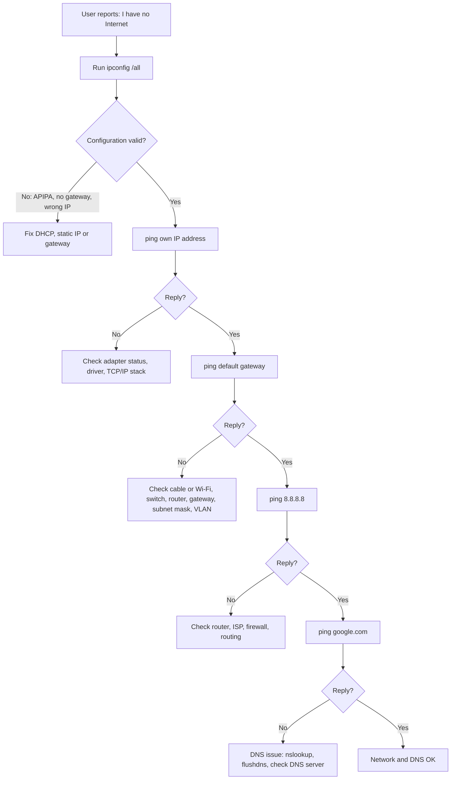

# 🔴 Scenario 1 - No Internet Investigation

[ Back to Project README] → [README.md](./README.md)

---

## 📋 Problem Summary

A user reports "I have no Internet". The cause is unknown, so the PC is tested step by step from the inside out: configuration, local network, internet routing and DNS. The first step that fails shows where the problem is.

---

## 💡 What is a No Internet Investigation?

"No internet" is a symptom, not a cause. A fault at any layer produces it, so each test checks one layer and the next test runs only if the previous one passes.

| Layer | Test | A failure points to |
|-------|------|---------------------|
| IP configuration | `ipconfig /all` | APIPA address, missing gateway, wrong IP, DHCP problem |
| Local adapter | `ping <Own IP>` | Adapter, driver or TCP/IP stack |
| Local network | `ping <Default Gateway>` | Cable, Wi-Fi, switch, router, wrong gateway or subnet mask, VLAN |
| Internet routing | `ping 8.8.8.8` | Router, ISP, firewall or routing |
| DNS | `ping google.com` | DNS server or DNS settings |

> **First check:** always start with `ipconfig /all`, because a wrong configuration makes every later test fail.

---

## 🎯 Diagnostic Flowchart



---

## 🔎 Verify the Problem

Run the tests in order and stop at the first failure.

| Step | Command | Reply ✅ | No reply ❌ |
|:----:|---------|---------|-------------|
| 1 | `ipconfig /all` | IP address, mask, gateway and DNS look correct | Fix the configuration first (APIPA, no gateway, wrong IP) |
| 2 | `ping 192.168.10.50` (own IP) | The adapter has a working IP configuration | Check the adapter status, driver or TCP/IP stack |
| 3 | `ping 192.168.10.1` (default gateway) | The local network works | Check the cable or Wi-Fi, switch, router, gateway, subnet mask or VLAN |
| 4 | `ping 8.8.8.8` | The internet is reachable | Check the router, ISP, firewall or routing |
| 5 | `ping google.com` | Network and DNS both work | DNS fault: run `nslookup google.com` and check the DNS server |

> Replace `192.168.10.50` and `192.168.10.1` with the PC's own address and default gateway from `ipconfig /all`.

**Screenshot: diagnostic tests:**


---

## 🔧 Fix

Fix the layer where the first test failed, then repeat the tests from that step.

| Failed step | Fix |
|-------------|-----|
| 1. Configuration | Set the adapter to Automatic (DHCP), or correct the static IP, mask and gateway |
| 2. Own IP | Enable the adapter, update the driver, or reset the stack with `netsh int ip reset` |
| 3. Gateway | Check the cable or Wi-Fi connection, the switch port and the gateway address |
| 4. Internet | Check the router and the ISP connection |
| 5. DNS | Set a valid DNS server (for example `8.8.8.8`), or run `ipconfig /flushdns` |

> Resolve connectivity problems before troubleshooting DNS, because DNS cannot work without a network path.

---

## ✅ Verification

| Command | Result | Meaning |
|---------|--------|---------|
| `ipconfig /all` | Valid IP, mask, gateway and DNS | Correct configuration |
| `ping 192.168.10.1` | Reply ✅ | The local network works |
| `ping 8.8.8.8` | Reply ✅ | The internet is reachable |
| `ping google.com` | Reply ✅ | DNS and the internet both work |

---

## 📋 Issue Summary

| | Detail |
|---|---|
| **Issue** | The user has no internet access |
| **Cause** | Depends on the step that failed: configuration, local network, internet route or DNS |
| **Symptom** | Websites do not open; the failing ping shows which layer is affected |
| **Diagnose** | Tested in order with `ipconfig /all`, own IP, gateway, `8.8.8.8` and `google.com` |
| **Fix** | Corrected the layer where the first test failed |
| **Verified** | Gateway, `8.8.8.8` and `google.com` all replied |

---

## 🔗 Related Lab

→ [Cannot Reach Default Gateway](https://github.com/seemasm20-source/networking-labs/blob/main/04-tcp-ip-network-troubleshooting/project%203-connectivity/cannot-ping-gateway.md)


 
 ## 🔴 Scenario 1 - No Internet Investigation


      
      
      
      🎯 The 5-Step Diagnostic Flowchart


# 🌐 No Internet Connectivity - Troubleshooting Flowchart

```text
                     User reports:
                  "I have no Internet"
                           │
                           ▼
                 Run: ipconfig /all
                           │
                           ▼
            ┌────────────────────────────────┐
            │ Check the following:           │
            │ • IPv4 Address                 │
            │ • Subnet Mask                  │
            │ • Default Gateway              │
            │ • DNS Server                   │
            │ • DHCP Enabled                 │
            └────────────────────────────────┘
                           │
          ┌────────────────┴────────────────┐
          │                                 │
          ▼                                 ▼
  Invalid Configuration?             Configuration OK
(APIPA, No Gateway, Wrong IP)               │
          │                                 │
 Fix DHCP / Static IP / Gateway             ▼
                                    ping <Own IP Address>
                                    (Example: 192.168.56.1)
                                             │
                        ┌────────────────────┴────────────────────┐
                        │                                         │
                        ▼                                         ▼
                 Reply ✅                                  No Reply ❌
          NIC and IP configuration OK           Check NIC status, adapter,
                                                driver, or TCP/IP stack
                        │
                        ▼
              ping <Default Gateway>
              (Example: 192.168.10.1)
                        │
           ┌────────────┴────────────┐
           │                         │
           ▼                         ▼
      Reply ✅                 No Reply ❌
 Local network OK          Check:
                           • Wi-Fi / Ethernet cable
                           • Switch / Router
                           • Wrong Gateway
                           • Wrong Subnet Mask
                           • VLAN (Enterprise)
                        │
                        ▼
                  ping 8.8.8.8
                        │
           ┌────────────┴────────────┐
           │                         │
           ▼                         ▼
      Reply ✅                 No Reply ❌
 Internet reachable        No Internet route
                            Check:
                            • Router
                            • ISP
                            • Firewall
                            • Routing
                        │
                        ▼
                ping google.com
                        │
           ┌────────────┴────────────┐
           │                         │
           ▼                         ▼
      Reply ✅                 No Reply ❌
 Network & DNS OK          DNS Resolution Issue
                           Check:
                           • nslookup google.com
                           • ipconfig /flushdns
                           • Verify DNS Server
                           • Change DNS (8.8.8.8)
```

---


## 🎯 Troubleshooting Logic

| Step | Command | Purpose |
|------|---------|---------|
| 1 | `ipconfig /all` | Verify IP configuration (IP, Gateway, DNS, DHCP) |
| 2 | `ping <Own IP>` | Verify NIC and local IP configuration |
| 3 | `ping <Default Gateway>` | Verify local network connectivity |
| 4 | `ping 8.8.8.8` | Verify Internet connectivity |
| 5 | `ping google.com` | Verify DNS name resolution |

---


## 💡 Key Learning

- If `ping <Own IP>` fails → Investigate the network adapter (NIC) or IP configuration.
- If `ping <Default Gateway>` fails → The PC cannot communicate with the local network.
- If `ping 8.8.8.8` fails → There is no working route to the Internet.
- If `ping 8.8.8.8` works but `ping google.com` fails → This indicates a DNS resolution issue.
- Always resolve network connectivity issues before troubleshooting DNS.


